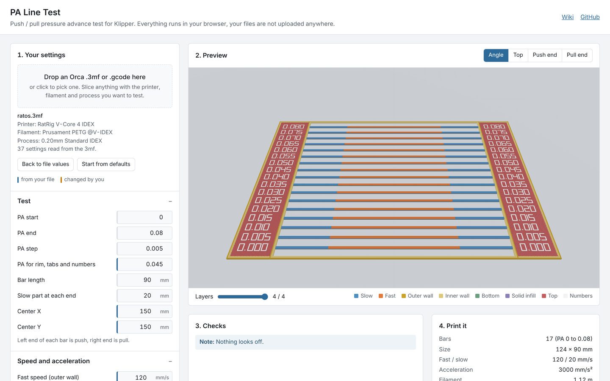

# pa_line_test

Push / pull PA line test from your Orca 3mf. No slicer, no upload, no excuses.

**Use it here: https://vcikeythecoder.github.io/pa_line_test/**



Each bar prints slow, fast, slow at one PA value. Read the left end (speeding up)
for push and the right end (slowing down) for pull. Works with normal Klipper
pressure advance, and with [dual_pa](https://github.com/VcikeyTheCoder/dual_pa)
if you want both values.

## How to use

1. Slice anything in Orca with the printer, filament and process you want to
   test. Save the project (.3mf) or export the G-code.
2. Drop it on the page. It reads speeds, acceleration, flow ratio, max
   volumetric speed, temps, retraction, bed size and your start G-code.
3. Change anything you want. Fields from your file have a blue edge, the ones
   you changed have an orange one. No file? Use "Start from defaults" and fill
   it in.
4. Check the preview and the checks, then download the G-code and print it.

Everything runs in your browser. Your files are not uploaded and nothing is
saved anywhere.

More in the [wiki](https://github.com/VcikeyTheCoder/pa_line_test/wiki).

## What it needs

- Klipper (the test uses `SET_PRESSURE_ADVANCE` and `SET_VELOCITY_LIMIT`)
- A 3mf or G-code from OrcaSlicer or Bambu Studio, or your settings typed in

## Run it yourself

It's plain HTML and JavaScript, no build step. Serve the folder with anything:

```
python3 -m http.server 8000
```

Tests: `node tests/test.mjs`

## Maintainer

Made and maintained by ONBOX_CREATIONS. Issues and pull requests are welcome.

## Credits

Line test idea from auto PA ([piro-air-pa-calibrator](https://github.com/VcikeyTheCoder/piro-air-pa-calibrator)).

## License

GNU GPLv3
